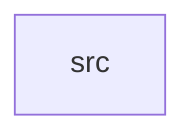

_Generated by CodeAtlas._

## Details

Owns 0 symbols across 1 file(s).

### src

Owns 17 symbols across 1 file(s).

**Related Classes/Methods:** _None_

**Source Files:**

- `bindings/src/lib.rs`
  - `bindings.src.lib._core`
  - `bindings.src.lib.baseline`
  - `bindings.src.lib.diff`
  - `bindings.src.lib.discover`
  - `bindings.src.lib.discover_directory`
  - `bindings.src.lib.graph_add_agent`
  - `bindings.src.lib.graph_blast_radius`
  - `bindings.src.lib.graph_load_mcp`
  - `bindings.src.lib.graph_reachable`
  - `bindings.src.lib.load_inventory`
  - `bindings.src.lib.persist`
  - `bindings.src.lib.policies_diff`
  - `bindings.src.lib.policies_emit_envoy`
  - `bindings.src.lib.policies_recommend`
  - `bindings.src.lib.policies_validate`
  - `bindings.src.lib.remediate`
  - `bindings.src.lib.report`
