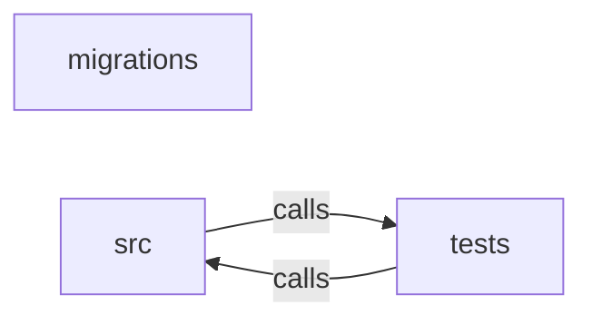

_Generated by CodeAtlas._

## Details

Owns 0 symbols across 1 file(s).

### migrations

Owns 0 symbols across 2 file(s).

**Related Classes/Methods:** _None_

### src

Owns 233 symbols across 18 file(s).

**Related Classes/Methods:** _None_

**Source Files:**

- `core/src/baseline.rs`
  - `core.src.baseline.BolaFinding`
  - `core.src.baseline.FirstTimeOperation`
  - `core.src.baseline.IdentityBaseline`
  - `core.src.baseline.build_baselines`
  - `core.src.baseline.build_one_baseline`
  - `core.src.baseline.coefficient_of_variation`
  - `core.src.baseline.detect_first_time_operations`
  - `core.src.baseline.detect_sequential_id_access`
  - `core.src.baseline.extract_numeric_segment`
  - `core.src.baseline.longest_sequential_run`
  - `core.src.baseline.operation_key`
  - `core.src.baseline.parse_timestamp`
  - `core.src.baseline.single_numeric_param_index`
  - `core.src.baseline.tests.baseline_computes_error_rate_and_distinct_resources`
  - `core.src.baseline.tests.detects_sequential_id_enumeration`
  - `core.src.baseline.tests.first_time_operation_flags_only_the_genuinely_new_one`
  - `core.src.baseline.tests.first_time_operation_is_deduped_within_the_same_batch`
  - `core.src.baseline.tests.identity_less_records_are_excluded_from_baselines`
  - `core.src.baseline.tests.known_agent_flag_is_set_from_caller_supplied_set`
  - `core.src.baseline.tests.record`
  - `core.src.baseline.tests.regular_machine_timing_has_low_coefficient_of_variation`
  - `core.src.baseline.tests.scattered_id_access_is_not_flagged`
- `core/src/classify.rs`
  - `core.src.classify.Classifier`
  - `core.src.classify.FieldClassification`
  - `core.src.classify.KeywordClassifier`
  - `core.src.classify.KeywordClassifier.classify`
  - `core.src.classify.classify_field`
  - `core.src.classify.tests.flags_credentials`
  - `core.src.classify.tests.flags_financial_identifiers`
  - `core.src.classify.tests.is_case_insensitive`
  - `core.src.classify.tests.leaves_unknown_fields_unclassified`
- `core/src/db.rs`
  - `core.src.db.connect`
  - `core.src.db.load_inventory`
  - `core.src.db.load_traffic`
  - `core.src.db.migrate`
  - `core.src.db.persist_inventory`
  - `core.src.db.persist_traffic`
  - `core.src.db.tests.persists_and_counts_traffic_records`
  - `core.src.db.tests.round_trips_an_inventory_through_postgres`
  - `core.src.db.tests.round_trips_traffic_records_including_identity`
  - `core.src.db.tests.test_pool_or_skip`
  - `core.src.db.tests.upserting_the_same_inventory_source_creates_a_new_history_row`
- `core/src/discover_dir.rs`
  - `core.src.discover_dir.discover_from_directory`
  - `core.src.discover_dir.is_spec_filename`
  - `core.src.discover_dir.tests.empty_directory_returns_empty_vec_not_error`
  - `core.src.discover_dir.tests.finds_specs_in_nested_services_and_ignores_noise_dirs`
  - `core.src.discover_dir.tests.write`
  - `core.src.discover_dir.walk`
- `core/src/drift.rs`
  - `core.src.drift.DriftReport`
  - `core.src.drift.EndpointChange`
  - `core.src.drift.EndpointRef`
  - `core.src.drift.FieldChange`
  - `core.src.drift.diff_inventories`
  - `core.src.drift.key`
  - `core.src.drift.sensitive_field_signature`
  - `core.src.drift.tests.detects_added_removed_and_changed_endpoints`
  - `core.src.drift.tests.identical_specs_produce_empty_report`
- `core/src/enforcement.rs`
  - `core.src.enforcement.ForbidRule`
  - `core.src.enforcement.emit_envoy_rbac`
  - `core.src.enforcement.extract_forbid_rules`
  - `core.src.enforcement.tests.empty_policy_set_emits_nothing`
  - `core.src.enforcement.tests.generated_snippet_is_syntactically_valid_yaml`
  - `core.src.enforcement.tests.multiple_forbid_policies_each_get_a_rule`
  - `core.src.enforcement.tests.permit_only_policy_set_emits_nothing`
  - `core.src.enforcement.tests.translates_a_forbid_policy_into_a_deny_rule`
  - `core.src.enforcement.yaml_string`
- `core/src/graph.rs`
  - `core.src.graph.EdgeLabel`
  - `core.src.graph.EdgeLabel.as_str`
  - `core.src.graph.ReachableNode`
  - `core.src.graph.VertexLabel`
  - `core.src.graph.VertexLabel.as_str`
  - `core.src.graph.blast_radius`
  - `core.src.graph.connect`
  - `core.src.graph.cypher_string`
  - `core.src.graph.ensure_graph`
  - `core.src.graph.ensure_label`
  - `core.src.graph.extension_exists`
  - `core.src.graph.graph_exists`
  - `core.src.graph.label_exists`
  - `core.src.graph.reachable_from`
  - `core.src.graph.tests.agent_can_reach_its_declared_tools_and_their_resources`
  - `core.src.graph.tests.cypher_string_rejects_newlines_but_escapes_quotes`
  - `core.src.graph.tests.test_pool_or_skip`
  - `core.src.graph.tests.unique_suffix`
  - `core.src.graph.tests.upserting_an_mcp_server_records_its_discovered_tools`
  - `core.src.graph.tests.wiring_an_agent_to_an_undiscovered_tool_fails`
  - `core.src.graph.traverse`
  - `core.src.graph.upsert_agent`
  - `core.src.graph.upsert_edge`
  - `core.src.graph.upsert_mcp_server`
  - `core.src.graph.upsert_vertex`
- `core/src/lib.rs`
  - `core.src.lib.BaselineResult`
  - `core.src.lib.RemediationPlan`
  - `core.src.lib.ReportResult`
  - `core.src.lib.baseline_from_files`
  - `core.src.lib.diff_files`
  - `core.src.lib.discover_from_file`
  - `core.src.lib.discover_from_str`
  - `core.src.lib.discover_from_str_with_classifier`
  - `core.src.lib.emit_envoy_rbac_from_file`
  - `core.src.lib.policy_diff_from_files`
  - `core.src.lib.policy_recommendations_from_files`
  - `core.src.lib.remediate_from_file`
  - `core.src.lib.remediate_from_str`
  - `core.src.lib.report_from_files`
  - `core.src.lib.validate_policy_file`
- `core/src/lifecycle.rs`
  - `core.src.lifecycle.ActiveEndpoint`
  - `core.src.lifecycle.LifecycleReport`
  - `core.src.lifecycle.ShadowEndpoint`
  - `core.src.lifecycle.ZombieEndpoint`
  - `core.src.lifecycle.build_lifecycle_report`
  - `core.src.lifecycle.path_matches_template`
  - `core.src.lifecycle.tests.classifies_active_zombie_and_shadow`
  - `core.src.lifecycle.tests.no_traffic_means_everything_declared_is_zombie`
- `core/src/mcp.rs`
  - `core.src.mcp.DiscoveredMcpServer`
  - `core.src.mcp.McpServerConfig`
  - `core.src.mcp.ToolDiscoveryResult`
  - `core.src.mcp.discover_all`
  - `core.src.mcp.discover_tools`
  - `core.src.mcp.discover_tools_inner`
  - `core.src.mcp.parse_mcp_config`
  - `core.src.mcp.read_message`
  - `core.src.mcp.run_handshake`
  - `core.src.mcp.send_message`
  - `core.src.mcp.tests.live_discovery_against_fixture_server_returns_real_tools`
  - `core.src.mcp.tests.missing_command_is_reported_unavailable_not_silently_empty`
  - `core.src.mcp.tests.parses_mcp_servers_config_and_keeps_only_env_key_names`
  - `core.src.mcp.tests.rejects_config_with_no_mcp_servers_key`
- `core/src/model.rs`
  - `core.src.model.AgentIdentity`
  - `core.src.model.Endpoint`
  - `core.src.model.EndpointDraft`
  - `core.src.model.Inventory`
  - `core.src.model.InventorySummary`
  - `core.src.model.RiskFactor`
  - `core.src.model.RiskScore`
  - `core.src.model.SensitiveField`
  - `core.src.model.dedupe_sensitive_fields`
  - `core.src.model.summarize`
- `core/src/openapi.rs`
  - `core.src.openapi.collect_fields`
  - `core.src.openapi.collect_sensitive_from_content`
  - `core.src.openapi.extract_security`
  - `core.src.openapi.parse_spec`
  - `core.src.openapi.parse_spec_with_classifier`
  - `core.src.openapi.resolve_ref`
  - `core.src.openapi.tests.NeverClassifier`
  - `core.src.openapi.tests.NeverClassifier.classify`
  - `core.src.openapi.tests.alternate_classifier_is_actually_used`
- `core/src/policy.rs`
  - `core.src.policy.PolicyGap`
  - `core.src.policy.PolicyRecommendation`
  - `core.src.policy.PolicySummary`
  - `core.src.policy.build_forbid_policy`
  - `core.src.policy.cedar_string`
  - `core.src.policy.diff_against_policy`
  - `core.src.policy.endpoint_resource_name`
  - `core.src.policy.evaluate`
  - `core.src.policy.parse_policy_set`
  - `core.src.policy.principal_type`
  - `core.src.policy.recommend_from_bola_findings`
  - `core.src.policy.recommend_from_first_time_operations`
  - `core.src.policy.summarize_policy_set`
  - `core.src.policy.tests.bola`
  - `core.src.policy.tests.diff_flags_a_finding_a_broad_permit_would_currently_allow`
  - `core.src.policy.tests.diff_reports_no_gap_when_policy_already_denies_by_default`
  - `core.src.policy.tests.first_time`
  - `core.src.policy.tests.known_agent_generates_agent_typed_principal`
  - `core.src.policy.tests.recommended_policy_text_is_valid_cedar_and_denies_the_exact_request`
  - `core.src.policy.tests.summarize_reports_effect_and_annotations`
  - `core.src.policy.tests.validate_surfaces_real_cedar_parse_errors`
- `core/src/postman.rs`
  - `core.src.postman.collect_from_body`
  - `core.src.postman.collect_from_query`
  - `core.src.postman.collect_json_keys`
  - `core.src.postman.extract_path`
  - `core.src.postman.is_nonempty_auth_header`
  - `core.src.postman.is_postman_collection`
  - `core.src.postman.normalize_segment`
  - `core.src.postman.parse_collection`
  - `core.src.postman.push_if_classified`
  - `core.src.postman.strip_origin`
  - `core.src.postman.tests.normalizes_path_variables_and_detects_auth_header`
  - `core.src.postman.tests.recognizes_postman_shape_and_not_openapi`
  - `core.src.postman.tests.sample_collection`
  - `core.src.postman.tests.unauthenticated_request_with_sensitive_body_is_flagged`
  - `core.src.postman.walk_items`
- `core/src/remediate.rs`
  - `core.src.remediate.SpecFix`
  - `core.src.remediate.apply_fixes`
  - `core.src.remediate.compute_fixes`
  - `core.src.remediate.declared_security_scheme_names`
  - `core.src.remediate.escape_pointer`
  - `core.src.remediate.generate_operation_id`
  - `core.src.remediate.sanitize_segment`
  - `core.src.remediate.tests.apply_fixes_on_path_with_param_uses_correct_json_pointer`
  - `core.src.remediate.tests.apply_fixes_skips_missing_metadata_when_operation_id_already_present`
  - `core.src.remediate.tests.apply_fixes_writes_security_referencing_the_scheme`
  - `core.src.remediate.tests.end_to_end_against_sample_fixture_fixes_both_unauthenticated_endpoints`
  - `core.src.remediate.tests.endpoint_for`
  - `core.src.remediate.tests.missing_metadata_fix_generates_deterministic_operation_id`
  - `core.src.remediate.tests.no_auth_fix_references_declared_scheme`
  - `core.src.remediate.tests.no_auth_produces_no_fix_when_no_scheme_declared`
  - `core.src.remediate.tests.spec_with_unused_scheme`
- `core/src/risk.rs`
  - `core.src.risk.is_mutating`
  - `core.src.risk.level_for`
  - `core.src.risk.score_endpoint`
  - `core.src.risk.tests.base_draft`
  - `core.src.risk.tests.clean_endpoint_scores_zero`
  - `core.src.risk.tests.unauthenticated_endpoint_with_sensitive_data_is_critical`
  - `core.src.risk.tests.unauthenticated_mutating_endpoint_is_high_risk`
- `core/src/text_patch.rs`
  - `core.src.text_patch.Target`
  - `core.src.text_patch.field_value_json`
  - `core.src.text_patch.field_value_yaml`
  - `core.src.text_patch.find_json_operation_line`
  - `core.src.text_patch.find_yaml_operation_line`
  - `core.src.text_patch.indent_of`
  - `core.src.text_patch.patch_json_text`
  - `core.src.text_patch.patch_yaml_text`
  - `core.src.text_patch.tests.fix`
  - `core.src.text_patch.tests.json_patch_inserts_operation_id`
  - `core.src.text_patch.tests.json_patch_inserts_security_when_no_existing_key`
  - `core.src.text_patch.tests.json_patch_replaces_existing_security_line`
  - `core.src.text_patch.tests.unlocatable_fix_is_skipped_without_panicking`
  - `core.src.text_patch.tests.yaml_patch_inserts_operation_id`
  - `core.src.text_patch.tests.yaml_patch_inserts_security_when_no_existing_key`
  - `core.src.text_patch.tests.yaml_patch_preserves_comments_and_order`
  - `core.src.text_patch.tests.yaml_patch_targets_correct_path_when_multiple_paths_present`
  - `core.src.text_patch.yaml_key_matches`
- `core/src/traffic.rs`
  - `core.src.traffic.TrafficRecord`
  - `core.src.traffic.first_status_field`
  - `core.src.traffic.first_str_field`
  - `core.src.traffic.parse_access_log`
  - `core.src.traffic.parse_line`
  - `core.src.traffic.tests.extracts_identity_when_present_and_leaves_it_none_when_absent`
  - `core.src.traffic.tests.parses_envoy_shaped_json_log`
  - `core.src.traffic.tests.parses_nginx_shaped_json_log`
  - `core.src.traffic.tests.skips_blank_and_malformed_lines_without_failing`

### tests

Owns 9 symbols across 1 file(s).

**Related Classes/Methods:** _None_

**Source Files:**

- `core/tests/discover_test.rs`
  - `core.tests.discover_test.authenticated_endpoints_with_pii_are_not_critical`
  - `core.tests.discover_test.deprecated_endpoint_still_present_is_flagged_low`
  - `core.tests.discover_test.destructive_delete_without_auth_is_high_risk`
  - `core.tests.discover_test.discovers_every_declared_endpoint`
  - `core.tests.discover_test.find`
  - `core.tests.discover_test.global_security_applies_to_endpoints_without_an_override`
  - `core.tests.discover_test.load_fixture`
  - `core.tests.discover_test.refunds_endpoint_is_flagged_critical_for_unauthenticated_financial_data`
  - `core.tests.discover_test.summary_counts_are_consistent_with_endpoint_flags`
