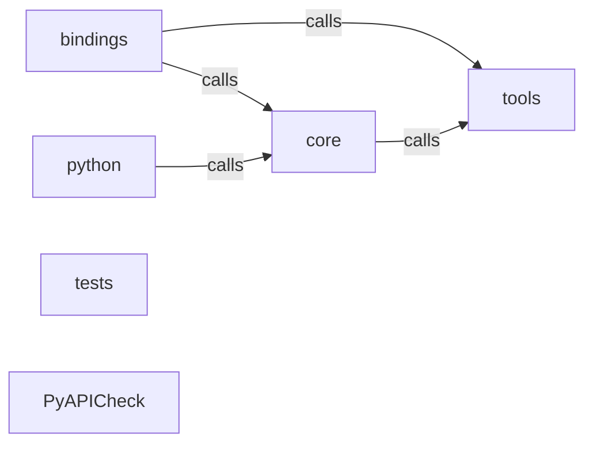

_Generated by CodeAtlas._

## Details

Architecture map of PyAPICheck.

### bindings

Owns 0 symbols across 1 file(s).

**Related Classes/Methods:** _None_

### core

Owns 0 symbols across 1 file(s).

**Related Classes/Methods:** _None_

### python

Owns 0 symbols across 0 file(s).

**Related Classes/Methods:** _None_

### tests

Owns 14 symbols across 2 file(s).

**Related Classes/Methods:** _None_

**Source Files:**

- `tests/test_codeatlas_adapter.py`
  - `tests.test_codeatlas_adapter._run`
  - `tests.test_codeatlas_adapter.test_check_reports_the_embedded_engine_available`
  - `tests.test_codeatlas_adapter.test_diagnose_summarises_the_architecture_map`
  - `tests.test_codeatlas_adapter.test_explain_reports_an_unknown_node_as_an_error`
  - `tests.test_codeatlas_adapter.test_god_nodes_are_ranked_by_degree`
- `tests/test_remediate.py`
  - `tests.test_remediate.TestRemediateCli`
  - `tests.test_remediate.TestRemediateCli.test_apply_writes_the_patched_file`
  - `tests.test_remediate.TestRemediateCli.test_dry_run_does_not_write`
  - `tests.test_remediate.TestRemediateCli.test_json_flag_prints_full_plan`
  - `tests.test_remediate.TestRemediateCli.test_missing_file_is_a_clean_error`
  - `tests.test_remediate.TestRemediateCli.test_no_fixable_findings_reports_cleanly`
  - `tests.test_remediate.test_remediate_finds_the_two_unauthenticated_endpoints`
  - `tests.test_remediate.test_remediate_patched_text_is_a_minimal_diff`
  - `tests.test_remediate.test_remediate_patched_text_reparses_as_authenticated`

### tools

Owns 0 symbols across 0 file(s).

**Related Classes/Methods:** _None_

### PyAPICheck

Owns 0 symbols across 12 file(s).

**Related Classes/Methods:** _None_
