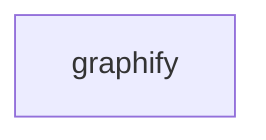

_Generated by CodeAtlas._

## Details

Owns 0 symbols across 0 file(s).

### graphify

Owns 10 symbols across 2 file(s).

**Related Classes/Methods:** _None_

**Source Files:**

- `tools/graphify/graphify_adapter.py`
  - `tools.graphify.graphify_adapter._emit`
  - `tools.graphify.graphify_adapter._graphify_out`
  - `tools.graphify.graphify_adapter._passthrough`
  - `tools.graphify.graphify_adapter._run`
  - `tools.graphify.graphify_adapter._unavailable`
  - `tools.graphify.graphify_adapter.build_parser`
  - `tools.graphify.graphify_adapter.build_parser.common`
  - `tools.graphify.graphify_adapter.cmd_build`
  - `tools.graphify.graphify_adapter.cmd_check`
  - `tools.graphify.graphify_adapter.main`
